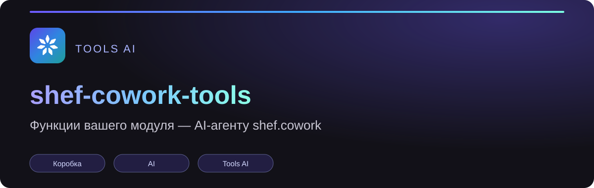

<p align="center">
  <a href="https://cowork.bx-shef.by/"></a>
</p>

<p align="center">
  <a href="https://cowork.bx-shef.by/"></a>
  
  <a href="https://github.com/bx-shef/shef-cowork-tools/releases"></a>
  <a href="https://github.com/bx-shef/shef-cowork-tools/blob/main/LICENSE"></a>
  
</p>

# shef-cowork-tools

**shef.cowork — AI-агент для вашего бизнеса.** Он работает в портале Битрикс24 от имени сотрудника, читает и меняет
данные по правам этого сотрудника. Этот репозиторий — для разработчиков: как дать агенту **функции своего модуля**,
чтобы сотрудники могли попросить в чате «покажи выписки за неделю» или «найди заметку про релиз».

Модуль не правит сервер shef.cowork. Он регистрирует обычные REST-методы и один метод-**манифест** — список
инструментов с описаниями и схемами аргументов. Сервер читает манифест токеном каждого сотрудника и показывает
агенту эти функции отдельными инструментами.

Посадочная shef.cowork: <https://cowork.bx-shef.by/> (карточка «Что можно встроить»).

## Путь за 5 шагов

1. **Методы.** Модуль регистрирует свои REST-методы событием `rest` → `OnRestServiceBuildDescription` в своей
   области прав (например `demo_notes`). Сотрудник в методе — только `CurrentUser`. → [docs/box-module.md](docs/box-module.md)
2. **Манифест.** Один из методов отдаёт список инструментов: `name`, `description`, `method`, `kind`
   (`read` / `write` / `delete`), `input` (JSON Schema). → [docs/box-module.md](docs/box-module.md#поля-манифеста)
3. **Проверка.** Манифест проверяется теми же правилами, что и на сервере: `node tools/manifest-check.mjs`.
   → [docs/rules.md](docs/rules.md)
4. **Область.** Администратор портала выдаёт приложению shef.cowork область модуля, вписывает имя манифеста в
   «Модули портала» и открывает запись тем, кому нужно; сотрудники входят заново. → [docs/enable.md](docs/enable.md)
5. **Работа.** Инструменты видны агенту; вызовы идут в методы модуля токеном сотрудника, удаление — только после
   его «да» в окне AI.

Облачный портал: что подтверждено и что нет — [docs/cloud-app.md](docs/cloud-app.md).

## Что в репозитории

| что | где |
|---|---|
| Коробочный модуль: методы, манифест, поля, ошибки | [docs/box-module.md](docs/box-module.md) |
| Облачное приложение | [docs/cloud-app.md](docs/cloud-app.md) |
| Включение администратором | [docs/enable.md](docs/enable.md) |
| Правила инструментов | [docs/rules.md](docs/rules.md) |
| Минимальный модуль с одним инструментом чтения | [examples/box-module-minimal](examples/box-module-minimal) |
| Пример «импорт банковских выписок»: чтение, запись, удаление | [examples/client-bank](examples/client-bank) |
| Проверка манифеста (Node) | [tools/manifest-check.mjs](tools/manifest-check.mjs) |
| История изменений | [CHANGELOG.md](CHANGELOG.md) |

## Запуск примеров и проверок

Нужны PHP 8.1+ и Node 22+. Портал не нужен: код ядра Битрикс24 заменён заглушками
([tools/bitrix-stubs.php](tools/bitrix-stubs.php)).

```bash
npm test                                   # проверка манифеста, оба примера
php examples/box-module-minimal/bin/dump-manifest.php | node tools/manifest-check.mjs - demo.mcp.tools
php examples/client-bank/bin/dump-manifest.php 1 | node tools/manifest-check.mjs - demobank.mcp.tools
```

## REST Битрикс24

Как добавить свои методы в REST коробки и как назвать область — по документации REST Битрикс24
(репозиторий `bitrix-tools/b24-rest-docs`): статья
`settings/cloud-and-on-premise/on-premise/custom-methods.md` («Добавление своих методов в REST API коробочной версии»),
список областей — `api-reference/scopes/permissions.md`.

## Лицензия

Все права защищены ООО «БэИксШефБай», см. [LICENSE](LICENSE).

---

## Другие модули семейства Tools AI

| Модуль | Что делает |
|---|---|
| [toolsai-crm](https://github.com/bx-shef/toolsai-crm) | автооценка CRM: что может сорваться и что делать |
| [shef.toolsai](https://cowork.bx-shef.by/toolsai) | AI в звонках, сделках, чатах и письмах |
| [shef-ai-providers](https://github.com/bx-shef/shef-ai-providers) | как подключить модель |
| [toolsai-server-check](https://github.com/bx-shef/toolsai-server-check) | проверка вашего сервера |
